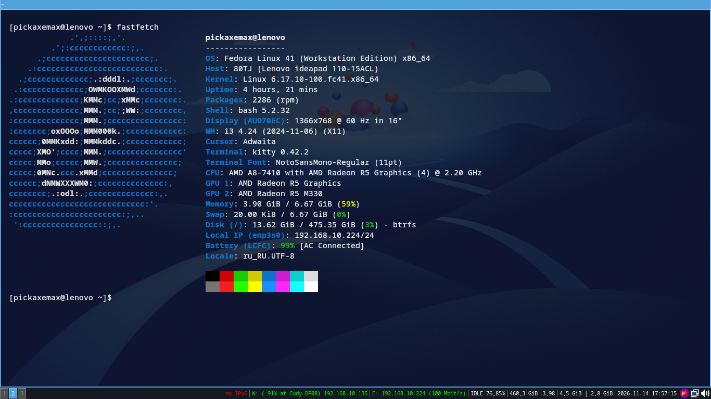

# Fedora-like i3 Desktop Config

> **ATTENTION:** This config is designed specifically for **Fedora Workstation 41**, as it uses the default Fedora 41 wallpaper path (`/usr/share/backgrounds/f41/default/f41-01-night.png`).



## Getting Ready

You need:
1. **Fedora Workstation 41**
2. **A computer** (PC or laptop)
3. **Keyboard and mouse** (any kind)

## How to Install

1. First, install the i3 desktop environment:
   ```bash
   sudo dnf install @i3-desktop-environment
   ```
2. Remove the default terminal (`xfce4-terminal`):
   ```bash
   sudo dnf remove xfce4-terminal
   ```
3. Install the required dependencies:
   ```bash
   sudo dnf install rofi kitty thunar flameshot picom feh
   ```
4. Download the config files and copy them into your `~/.config/` directory (don't forget to make `~/.config/i3/scripts/powermenu.sh` executable with `chmod +x`).
5. Log out (or type i3-msg restart), select **i3** on the login screen, and you are done!

## Keybindings

* **Win + Shift + E** (or **Alt + Shift + E**) — Opens the logout/shutdown menu (Rofi)
* **Alt + F** (or **Win + F**) — Opens Thunar file manager
* **Alt + D** (or **Win + D**) — Opens application launcher (Rofi / dmenu)
* **Alt + F4** — Force closes the active window
* **Print** — Takes a screenshot with Flameshot

*All other keybindings follow the i3 defaults.*
